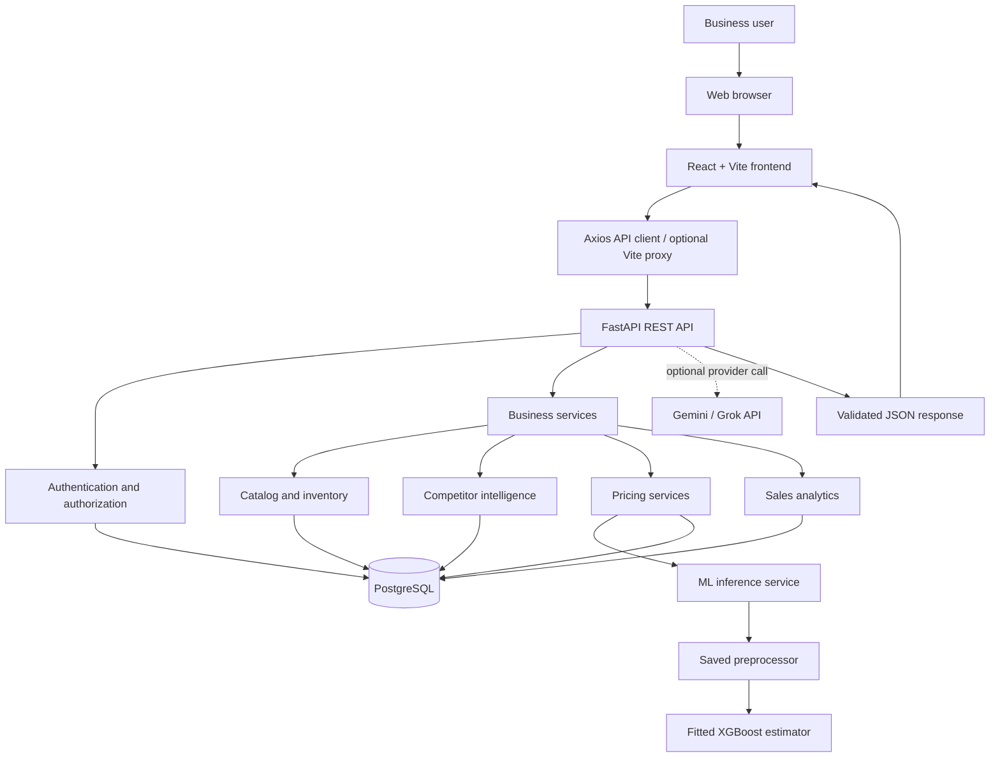
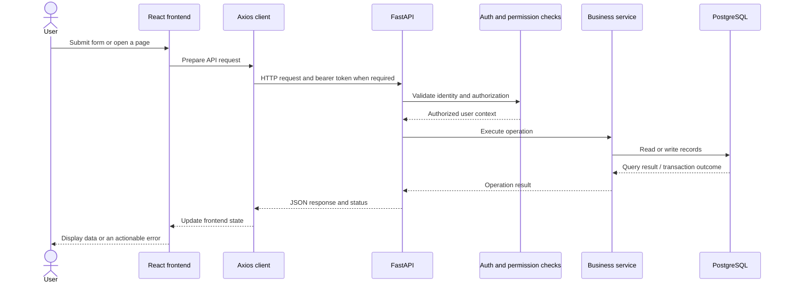
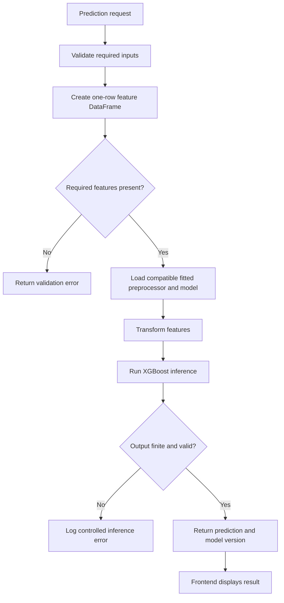
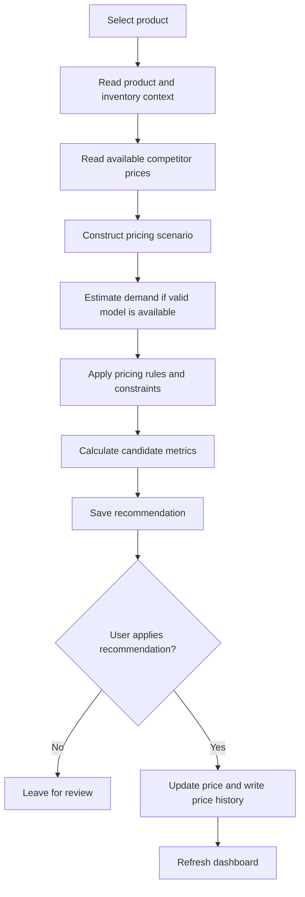
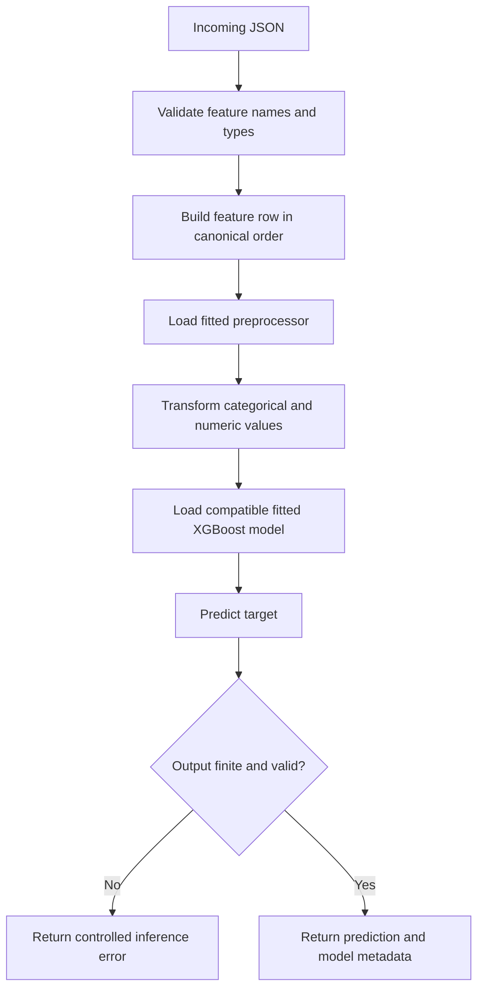
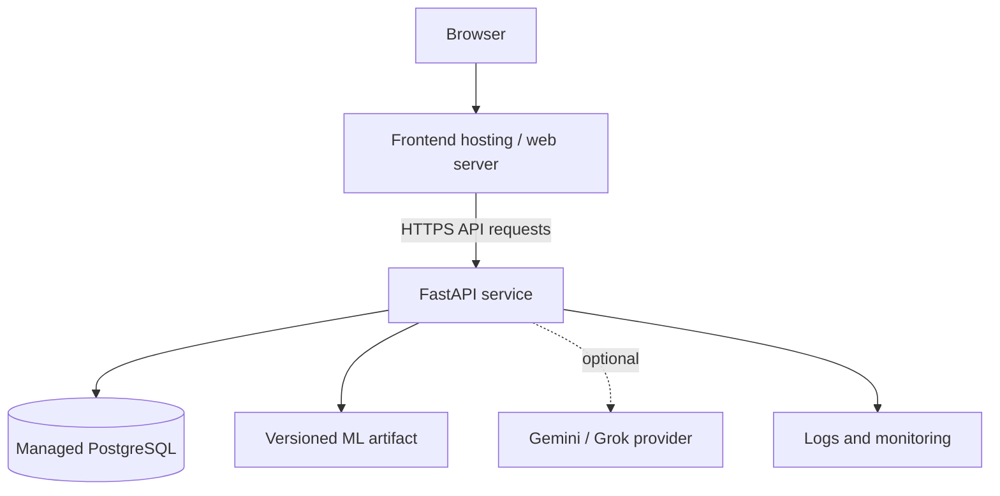

# PricePilot AI
## Dynamic Pricing Optimization & Revenue Intelligence System

PricePilot AI is a business-oriented platform for managing product catalogs and inventory, monitoring competitor prices, estimating demand, exploring pricing recommendations, and reviewing sales and revenue insights through a web dashboard.

The application follows a layered architecture: a React frontend communicates with a FastAPI REST API; backend services validate requests and apply business rules; PostgreSQL stores application records; and a saved XGBoost model is intended to support demand prediction. Optional Gemini/Grok integrations provide natural-language analysis when the configured provider and API key are available.

> **Implementation note:** This README documents the project from the available endpoint inventory and project context. Listing an endpoint does not prove it has passed testing. Use the running API's `/openapi.json` and `/docs` as the source of truth for exact schemas and current behavior. Known validation and model-artifact concerns are identified below.

## Table of Contents

- [Project Overview](#project-overview)
- [Features](#features)
- [Technology Stack](#technology-stack)
- [System Architecture](#system-architecture)
- [System Workflows](#system-workflows)
- [Frontend Architecture](#frontend-architecture)
- [Backend Architecture](#backend-architecture)
- [Database Design](#database-design)
- [Machine Learning Model](#machine-learning-model)
- [API Reference](#api-reference)
- [Local Setup](#local-setup)
- [Environment Variables](#environment-variables)
- [Testing and Current Status](#testing-and-current-status)
- [Security](#security)
- [Deployment](#deployment)
- [Troubleshooting](#troubleshooting)
- [Roadmap](#roadmap)

## Project Overview

Businesses must balance selling price, cost, demand, stock availability, promotions, and competitor prices. Static pricing can make it difficult to respond to changing market conditions. PricePilot AI brings these signals into one application to support more informed, data-driven pricing decisions.

### Objectives

1. Centralize product, category, variant, and inventory information.
2. Maintain competitor records and competitor-price observations.
3. Estimate demand from pricing, inventory, product, promotion, and calendar features.
4. Support pricing prediction and recommendation workflows.
5. Preserve pricing history for review and traceability.
6. Record sales and provide organization-level sales analytics.
7. Present operational and executive insights through a dashboard.
8. Offer optional LLM-based analysis through configured AI-provider endpoints.

### Intended users

| User | Typical responsibilities |
|---|---|
| Organization administrator | Manage organization, members, catalog, and access |
| Pricing analyst | Review competitor prices and pricing recommendations |
| Inventory manager | Maintain stock and review inventory levels |
| Business stakeholder | Monitor sales, revenue, and pricing performance |

## Features

| Module | Main capabilities |
|---|---|
| Authentication | Registration, login, token workflow, current-user lookup |
| Organization management | Create/retrieve organizations and manage members |
| Catalog management | Create, list, retrieve, update, and delete products; manage categories and variants |
| Inventory management | Retrieve and update inventory |
| Competitor intelligence | Create/update competitors, match products, record/retrieve competitor prices |
| Pricing engine | Run prediction, create/apply recommendations, retrieve price history |
| Sales analytics | Record sales and retrieve organization-level analytics |
| ML inference | Process feature input and predict when the fitted artifact is valid |
| AI assistant | Call configured Gemini/Grok providers for natural-language analysis |
| System monitoring | Root and health endpoints |

## Technology Stack

| Layer | Technology | Responsibility |
|---|---|---|
| Frontend | React, Vite, JavaScript | Interactive single-page application and build tooling |
| Styling | Tailwind CSS | Responsive interface styling |
| Navigation | React Router | Client-side page navigation |
| HTTP requests | Axios | API requests, headers, and response handling |
| Visualization | Recharts | Charts and analytics |
| Icons | Lucide React | Interface icons |
| Backend | Python, FastAPI, Uvicorn | REST API and application runtime |
| Validation | Pydantic | Request/response validation |
| ORM | SQLAlchemy | Relational data access |
| Database | PostgreSQL | Persistent application data |
| Migrations | Alembic | Versioned schema changes |
| Authentication | Bearer-token workflow and password hashing | Authentication and protected access |
| Machine learning | XGBoost, scikit-learn, pandas, NumPy | Preprocessing and demand prediction |
| External AI | Gemini/Grok APIs, if configured | Natural-language analysis |
| Testing | Swagger UI, pytest, Postman/HTTP client | Manual and automated verification |
| Packaging | Docker / Docker Compose, where configured | Reproducible runtime environments |

Exact dependency versions should be taken from repository manifests and lockfiles.

## System Architecture

### High-level architecture



### Layer responsibilities

| Layer | Responsibility | Validation focus |
|---|---|---|
| Presentation | Forms, tables, dashboards, charts | UI states, responsive behavior, form validation |
| API client | Sends requests and processes responses | Base URL, token headers, error handling |
| API routing | Parses requests and applies dependencies | Schema validation, status codes, route permissions |
| Business services | Pricing, competitor, inventory, sales logic | Correct calculations and consistent records |
| ML inference | Preprocesses input and predicts demand | Fitted artifact, feature order, output validation |
| Persistence | Stores tenant, catalog, pricing, and sales data | Constraints, transactions, tenant isolation |
| External AI provider | Generates natural-language output | API-key security, quotas, timeout, provider errors |

The browser should never connect directly to PostgreSQL. Provider secrets must remain on the backend and must not be exposed in frontend code.

## System Workflows

### 1. Authenticated API request



### 2. Demand prediction



### 3. Pricing recommendation



This is the intended workflow. Confirm the exact calculation sequence in the implemented pricing service before describing every step as production behavior.

### 4. Sales and analytics


Related sale and inventory changes should use a database transaction where both are part of the same operation.

## Frontend Architecture

The frontend is a React single-page application built with Vite. It provides the interface for catalog administration, inventory, competitor analysis, pricing workflows, and sales analytics.

### Responsibilities

- Render application layout, navigation, pages, forms, tables, and dashboards.
- Collect and validate input before submitting requests.
- Call FastAPI endpoints through Axios.
- Attach bearer tokens to protected requests according to the implemented authentication flow.
- Show loading, success, empty, and error states.
- Display price comparisons, recommendation results, and analytics charts.
- Handle temporary AI-provider errors without crashing the UI.

### Frontend request flow

```text
Page / Component
      |
      v
Feature service or hook
      |
      v
Axios client (base URL + headers)
      |
      v
FastAPI endpoint
      |
      v
JSON response or controlled error
      |
      v
React state -> component -> UI
```

### Illustrative folder organization

Actual repository paths may differ; use the checked-out project tree as the source of truth.

```text
frontend/
├── src/
│   ├── components/       # Shared UI components
│   ├── pages/            # Route-level screens
│   ├── features/         # Product, pricing, competitor, sales features
│   ├── services/         # Axios client and API functions
│   ├── hooks/            # Shared React hooks
│   ├── layouts/          # Page/application layouts
│   ├── utils/            # Formatters and helper functions
│   └── main.jsx          # Example application entry point
├── package.json
└── vite.config.*
```

### Frontend quality checks

| Area | Expected check |
|---|---|
| API base URL | Requests target the intended backend |
| Authentication | Expired or missing tokens are handled appropriately |
| Forms | Required fields and server validation errors are visible |
| Loading states | Duplicate submissions are prevented where necessary |
| Empty states | Empty catalog, competitor, or sales results are explained |
| Charts | Data is API-backed and empty data is handled |
| Errors | Stack traces and secrets are not shown to users |
| Production build | No unresolved imports or build errors |

## Backend Architecture

FastAPI provides the REST interface and coordinates request validation, authentication, business services, persistence, ML inference, and optional provider integrations.

### Responsibilities

1. Route HTTP requests to endpoint handlers.
2. Validate payloads and parameters using Pydantic schemas.
3. Authenticate callers and enforce organization/resource permissions.
4. Execute catalog, competitor, pricing, and sales operations.
5. Access PostgreSQL through SQLAlchemy.
6. Load the ML preprocessor and estimator for inference.
7. Call optional external AI providers and handle provider errors.
8. Return consistent JSON responses and safe HTTP errors.
9. Log diagnostics without exposing secrets.

### Illustrative folder organization

```text
backend/
├── app/
│   ├── main.py             # FastAPI application and router setup
│   ├── api/
│   │   ├── routes/         # Endpoint modules
│   │   └── dependencies/   # Auth and shared dependencies
│   ├── core/
│   │   ├── config.py       # Application settings
│   │   ├── security.py     # Password/token helpers
│   │   └── database.py     # Database engine and sessions
│   ├── models/             # SQLAlchemy models
│   ├── schemas/            # Pydantic schemas
│   ├── services/           # Pricing, competitor, sales, AI services
│   ├── ml/                 # Model loading, feature building, inference
│   └── repositories/       # Optional data-access layer
├── alembic/                # Database migrations
├── tests/                  # Automated tests
├── requirements.txt
└── Dockerfile              # If present
```

This is a reference layout, not a guarantee that every directory exists with these exact names.

## Database Design

PostgreSQL stores relational application data. SQLAlchemy provides ORM access and Alembic manages schema migrations.

| Table / entity | Purpose | Typical relationship |
|---|---|---|
| `users` | User accounts and identity | Can belong to organizations |
| `organizations` | Business/tenant accounts | Own catalog and operational records |
| `roles` | Role definitions | Used in authorization |
| `user_roles` | User-role mapping | Connects users and roles |
| `organization_members` | Organization membership | Connects users, organizations, and roles |
| `refresh_tokens` | Refresh-token lifecycle, if enabled | Associated with user/session |
| `categories` | Product classification | Organization-owned |
| `products` | Product catalog and price fields | Organization/category association |
| `product_variants` | Variants such as size or color | Belongs to a product |
| `inventory` | Stock levels and inventory fields | Associated with product/variant |
| `competitors` | Competitor records | Organization-owned |
| `competitor_products` | Competitor-to-product mappings | Connects competitor listings to internal products |
| `competitor_prices` | Competitor price observations | Associated with competitor product |
| `price_histories` | History of price changes | Associated with product |
| `pricing_recommendations` | Proposed pricing decisions | Associated with product and organization |
| `sales_records` | Sales transactions or line records | Associated with product and organization |
| `alembic_version` | Current migration revision | Managed by Alembic |

This is the known entity inventory, not a complete schema specification. Confirm exact columns, indexes, constraints, and foreign keys in ORM models and migrations.

### Data-integrity recommendations

- Enforce uniqueness for email, SKU, and other business keys where appropriate.
- Use foreign keys to prevent orphaned records.
- Use transactions for related writes.
- Check organization membership for every tenant-owned resource.
- Define what happens to historical records when products are deleted.
- Use decimal-safe representations for currency.
- Index commonly filtered fields such as organization ID, product ID, and timestamps.

## Machine Learning Model

### Purpose

The ML component is intended to estimate demand from product, pricing, inventory, competitor, promotion, and calendar features. The pricing service can use this estimate alongside business rules when evaluating scenarios.

**Demand prediction is not the same as optimal-price prediction.** Do not describe the model as directly finding the optimal price unless its training target and implemented optimization algorithm actually do that.

### Recorded model configuration

| Property | Recorded value |
|---|---|
| Algorithm | XGBoost regression |
| Estimator | `XGBRegressor` |
| Number of estimators | 500 |
| Learning rate | 0.05 |
| Maximum depth | 6 |
| Row subsampling | 0.8 |
| Feature subsampling | 0.8 |
| Objective | `reg:squarederror` |
| Random state | 42 |
| Parallel jobs | -1 |
| Raw input feature count | 26 |
| Recorded transformed shape | `(1, 64)` for one sample |
| Artifact path | `backend/saved_models/pricepilot_xgboost_model.pkl` |

These values reflect the recorded training setup and artifact location. They do not independently prove the current artifact is fitted or valid.

### Raw input features

| # | Feature | Role |
|---:|---|---|
| 1 | `Store ID` | Store identifier |
| 2 | `Product ID` | Product identifier |
| 3 | `Category` | Product category |
| 4 | `Region` | Business/geographic region |
| 5 | `Inventory Level` | Inventory signal |
| 6 | `Units Ordered` | Order/demand-related input |
| 7 | `Price` | Product price |
| 8 | `Discount` | Discount input |
| 9 | `Weather Condition` | Weather category |
| 10 | `Promotion` | Promotion indicator/value |
| 11 | `Competitor Pricing` | Competitor price benchmark |
| 12 | `Seasonality` | Seasonal signal |
| 13 | `Epidemic` | Dataset indicator |
| 14 | `Year` | Calendar year |
| 15 | `Month` | Month number |
| 16 | `Day` | Day of month |
| 17 | `Price Difference` | Difference between own and competitor price under the training definition |
| 18 | `Relative Price Difference` | Normalized price difference |
| 19 | `Price Position` | Relative competitive position |
| 20 | `Day of Week` | Weekday index |
| 21 | `Quarter` | Calendar quarter |
| 22 | `Week of Year` | Week number |
| 23 | `Month Sin` | Cyclical month encoding |
| 24 | `Month Cos` | Cyclical month encoding |
| 25 | `DayOfWeek Sin` | Cyclical weekday encoding |
| 26 | `DayOfWeek Cos` | Cyclical weekday encoding |

Feature definitions, category handling, date encoding, missing-value policy, and feature ordering must match the training pipeline exactly. Do not infer the exact formula from a feature name alone.

### Inference pipeline



### Previously recorded evaluation metrics

| Metric | Previously recorded value | Meaning |
|---|---:|---|
| MAE | 12.43384 | Mean absolute error in target units |
| RMSE | 17.23659 | Root mean squared error |
| R² | 0.8527401 | Explained-variance score on the evaluated split |
| MAPE | 18.9417% | Mean absolute percentage error, sensitive to zero/near-zero targets |

These are historical evaluation values from a previous notebook run. They must not be claimed as verified performance of the deployed artifact until the exact saved model is loaded and re-evaluated on held-out data.

### Model artifact validation warning

A previous diagnostic reported that the saved artifact contained an `XGBRegressor` object whose Booster was not fitted/loaded, while the preprocessor appeared fitted. If this remains true, the artifact is not ready for inference and should be rebuilt and saved correctly from the training pipeline.

Before release:

1. Load the artifact using the same Python environment as the API.
2. Confirm the estimator is fitted and can predict on a known valid input.
3. Verify that the preprocessor and estimator come from the same training run.
4. Compare direct inference with the API response for identical inputs.
5. Check outputs for NaN, infinity, and unexpected ranges.
6. Recompute evaluation metrics on held-out data.
7. Store model version, feature schema version, and training metadata with the artifact.

## API Reference

**Local base URL:** `http://127.0.0.1:8000`  
**Swagger UI:** `http://127.0.0.1:8000/docs`  
**ReDoc:** `http://127.0.0.1:8000/redoc`  
**OpenAPI JSON:** `http://127.0.0.1:8000/openapi.json`

The endpoints below come from the available project inventory. Request/response fields and authentication policies must be verified in the live OpenAPI schema. Most business endpoints are expected to be protected, but confirm the policy route by route.

### System and authentication

| Method | Endpoint | Purpose | Auth |
|---|---|---|---|
| GET | `/` | Root/service response | No |
| GET | `/health` | Health check | No |
| POST | `/api/v1/auth/register` | Register an account | Verify route policy |
| POST | `/api/v1/auth/login` | Authenticate a user | Usually public |
| POST | `/api/v1/auth/token` | Token workflow | Verify route policy |
| GET | `/api/v1/auth/me` | Retrieve current user | Yes |

### Users

| Method | Endpoint | Purpose | Auth |
|---|---|---|---|
| GET | `/api/v1/users/` | List accessible users | Yes |
| GET | `/api/v1/users/{user_id}` | Retrieve user by ID | Yes |
| PUT | `/api/v1/users/{user_id}` | Update user by ID | Yes |

### Organizations

| Method | Endpoint | Purpose | Auth |
|---|---|---|---|
| GET | `/api/v1/organizations/` | List organizations | Yes |
| POST | `/api/v1/organizations/` | Create organization | Yes |
| GET | `/api/v1/organizations/{org_id}` | Retrieve organization | Yes |
| POST | `/api/v1/organizations/{org_id}/members` | Add an organization member | Yes |

### Categories

| Method | Endpoint | Purpose | Auth |
|---|---|---|---|
| POST | `/api/v1/categories/` | Create category | Yes |
| GET | `/api/v1/categories/organization/{org_id}` | List organization categories | Yes |

### Products and inventory

| Method | Endpoint | Purpose | Auth |
|---|---|---|---|
| POST | `/api/v1/products/` | Create product | Yes |
| GET | `/api/v1/products/organization/{org_id}` | List organization products | Yes |
| GET | `/api/v1/products/{product_id}` | Retrieve product | Yes |
| PUT | `/api/v1/products/{product_id}` | Update product | Yes |
| DELETE | `/api/v1/products/{product_id}` | Delete product | Yes |
| POST | `/api/v1/products/{product_id}/variants` | Create product variant | Yes |
| GET | `/api/v1/products/{product_id}/inventory` | Retrieve inventory | Yes |
| PUT | `/api/v1/products/{product_id}/inventory` | Update inventory | Yes |

### Competitor intelligence

| Method | Endpoint | Purpose | Auth |
|---|---|---|---|
| POST | `/api/v1/competitors/` | Create competitor | Yes |
| GET | `/api/v1/competitors/organization/{org_id}` | List organization competitors | Yes |
| PUT | `/api/v1/competitors/{competitor_id}` | Update competitor | Yes |
| POST | `/api/v1/competitors/match` | Match competitor product to internal product | Yes |
| POST | `/api/v1/competitors/prices` | Record a competitor price | Yes |
| GET | `/api/v1/competitors/product/{product_id}/prices` | Retrieve competitor price observations | Yes |

### Pricing engine

| Method | Endpoint | Purpose | Auth |
|---|---|---|---|
| POST | `/api/v1/pricing/predict` | Run pricing/demand prediction workflow | Yes |
| POST | `/api/v1/pricing/recommendations` | Create a pricing recommendation | Yes |
| POST | `/api/v1/pricing/recommendations/{recommendation_id}/apply` | Apply a recommendation | Yes |
| GET | `/api/v1/pricing/history/{product_id}` | Retrieve product price history | Yes |

### Sales and analytics

| Method | Endpoint | Purpose | Auth |
|---|---|---|---|
| POST | `/api/v1/sales/` | Record a sale | Yes |
| GET | `/api/v1/sales/analytics/{organization_id}` | Retrieve organization sales analytics | Yes |

### AI endpoints

| Method | Endpoint | Purpose | Auth |
|---|---|---|---|
| POST | `/api/v2/ai/gemini` | Send prompt to configured Gemini provider | Verify route policy |
| POST | `/api/v2/ai/grok` | Send prompt to configured Grok provider, if enabled | Verify route policy |
| POST | `/api/v2/ai/predict` | Custom ML prediction endpoint | Verify route policy |

### Example requests

Health check:

```bash
curl http://127.0.0.1:8000/health
```

Protected endpoint:

```bash
curl -H "Authorization: Bearer <ACCESS_TOKEN>" \
  http://127.0.0.1:8000/api/v1/organizations/
```

Illustrative AI request body (the actual schema may differ by endpoint; use Swagger):

```json
{
  "model": "gemini-2.5-flash-lite",
  "prompt": "A product costs 500 and sells for 750. Calculate gross profit and gross margin, show calculations, and suggest two pricing strategies without inventing external market data.",
  "temperature": 0.4,
  "max_output_tokens": 256,
  "stop_sequences": []
}
```

The provider model must be available to the configured API key/account. Provider availability, quotas, and rate limits can change.

### Common HTTP statuses

| Code | Meaning | Typical action |
|---:|---|---|
| 200 | Request succeeded | Validate response contents |
| 201 | Resource created | Save returned ID and verify persistence |
| 204 | Success without response body | Do not parse JSON |
| 400 | Invalid business request | Explain the issue to the user |
| 401 | Missing/invalid authentication | Sign in or refresh credentials |
| 403 | Authenticated but not permitted | Check authorization |
| 404 | Resource not found | Verify resource ID and tenant |
| 409 | Resource conflict | Resolve duplicate/conflicting state |
| 422 | Request validation failed | Inspect `detail` and compare payload with schema |
| 429 | Rate limit exceeded | Respect retry instructions |
| 500 | Unexpected server error | Inspect server logs and return a safe error |
| 503 | Service temporarily unavailable | Retry with bounded exponential backoff |

## Local Setup

### Prerequisites

- Git
- Node.js and npm compatible with the frontend lockfile
- Python version supported by backend dependencies
- PostgreSQL, unless configured to use another database service
- Environment variables configured for the local environment
- Optional Gemini/Grok API key for AI features

### 1. Open the project

```powershell
cd C:\Infosys_project\PRICEPILOT_AI
```

### 2. Set up the backend environment

```powershell
cd backend
python -m venv venv
.\venv\Scripts\Activate.ps1
python -m pip install --upgrade pip
pip install -r requirements.txt
```

If `backend\venv` already exists, activate it rather than using a different root-level virtual environment. Backend dependencies must be installed in the environment used to run Uvicorn.

### 3. Configure PostgreSQL

Create the database named in your configured `DATABASE_URL`. The recorded local database name is `pricepilot_db`; username, password, host, and port depend on your local configuration.

### 4. Configure environment variables

Create the `.env` file at the location expected by the settings module. See [Environment Variables](#environment-variables). Never commit real keys.

### 5. Apply migrations

Run Alembic from the directory containing `alembic.ini`:

```powershell
alembic upgrade head
```

### 6. Start the backend

From `backend` with the backend virtual environment active:

```powershell
uvicorn app.main:app --reload --host 127.0.0.1 --port 8000
```

Open `http://127.0.0.1:8000/docs`.

### 7. Start the frontend

Open a second PowerShell terminal:

```powershell
cd C:\Infosys_project\PRICEPILOT_AI\frontend
npm install
npm run dev -- --host 0.0.0.0 --port 3000
```

Open `http://localhost:3000/` if the active Vite configuration uses port 3000. If Vite prints another URL, use the printed URL. Ensure the active Vite config points to `http://127.0.0.1:8000` or the configured backend URL.

### 8. Smoke-test

1. Open `/health`.
2. Open `/docs` and inspect live endpoint schemas.
3. Authenticate and obtain a token if required.
4. Call a protected endpoint with a bearer token.
5. Create a test product and retrieve it.
6. Verify database persistence.
7. Validate the ML artifact before relying on predictions.

## Environment Variables

The names below are examples, not a guarantee that every variable is read by the current settings module. Confirm exact names in backend configuration code.

```env
DATABASE_URL=postgresql+psycopg2://<USER>:<PASSWORD>@localhost:5432/pricepilot_db
SECRET_KEY=<LONG_RANDOM_SECRET>
ALGORITHM=HS256
ACCESS_TOKEN_EXPIRE_MINUTES=60

# Optional; exact names depend on implementation
GEMINI_API_KEY=<YOUR_GEMINI_API_KEY>
GROK_API_KEY=<YOUR_GROK_API_KEY>
```

- Keep `.env` out of version control.
- Never put provider API keys in React/Vite client code.
- Use separate secrets for development and production.
- Store production credentials in the hosting platform's secret manager.
- Rotate credentials if accidentally exposed.

## Testing and Current Status

### Testing levels

| Test type | Purpose | Example |
|---|---|---|
| Unit | Validate a single function or calculation | Margin calculation, feature engineering |
| API | Validate route contracts and status codes | Valid request, invalid payload, missing token |
| Integration | Verify API + database + service interaction | Create product, then retrieve it |
| ML validation | Check fitted model and predictive correctness | Direct inference, finite outputs, held-out metrics |
| Frontend | Check page interactions and error handling | Create product and display API errors |
| End-to-end | Verify complete business workflow | Product → competitor price → recommendation → apply → history |
| Security | Verify access control and tenant isolation | Organization A cannot read organization B's data |
| Performance | Measure latency and stability | Dashboard calls and prediction latency |

### Suggested manual test sequence

1. Check `/health`.
2. Register a test user and log in.
3. Verify `/api/v1/auth/me` with a bearer token.
4. Create an organization and category.
5. Create a product and check the product list.
6. Retrieve and update inventory.
7. Create a competitor and test product matching.
8. Submit a competitor price and retrieve price observations.
9. Run a pricing prediction.
10. Create and review a recommendation.
11. Apply the recommendation and inspect price history.
12. Record a sale and verify sales analytics and inventory consistency.
13. Test AI-provider error handling.
14. Test invalid/expired tokens and organization isolation.

### Current manual execution log

The latest provided execution log contains 37 API test rows:

| Status | Count | Interpretation |
|---|---:|---|
| Passed | 28 | Recorded as passed in the current log |
| Failed | 1 | `POST /api/v1/competitors/match` returned HTTP 422 |
| Not Run | 8 | Competitor pricing, pricing engine, and sales tests remain pending |
| Total | 37 | Manual execution log, not automated test coverage |

The pass rate among the 29 tests marked executed is **28 / 29 = 96.55%**. This is provisional and is not a measure of overall system correctness. Some entries lack recorded response evidence. A status code entered as an expected value for a test marked `Not Run` is not an observed result.

### Known ML limitation

A previous diagnostic reported a potentially unfitted XGBoost estimator in the serialized artifact. Revalidate the current artifact before claiming production-ready inference. HTTP 200 alone does not prove that the intended trained model generated a correct prediction.

## Security

- Require authentication for protected routes.
- Enforce organization membership and resource permissions in the backend, not only in frontend route guards.
- Hash passwords with a secure password-hashing scheme.
- Validate request bodies, query parameters, and path identifiers.
- Do not log passwords, bearer tokens, API keys, or sensitive payloads.
- Configure CORS for explicit frontend origins.
- Use ORM/parameterized database operations.
- Use database constraints and transactions for integrity.
- Return safe errors instead of stack traces or raw database errors.
- Use HTTPS in production.
- Add rate limits to sensitive operations as appropriate.
- Keep dependencies patched and exclude virtual environments and secrets from Git.

## Deployment



### Deployment checklist

- [ ] Frontend production build succeeds.
- [ ] Backend starts with production settings.
- [ ] Database migrations complete successfully.
- [ ] Production secrets are configured securely.
- [ ] CORS allows only intended origins.
- [ ] Model artifact is fitted, versioned, and readable.
- [ ] Health and API smoke tests pass.
- [ ] Provider failures are handled without crashing the service.
- [ ] Logs contain no secrets.
- [ ] Backups and migration rollback procedures are documented.
- [ ] Product-to-pricing end-to-end workflow is verified.

Describe Docker or cloud deployment as complete only after the actual deployment has been smoke-tested.

## Troubleshooting

| Problem | Possible cause | What to check |
|---|---|---|
| `ModuleNotFoundError: fastapi` | Wrong Python environment | Activate `backend\venv`; install requirements there |
| Vite proxy `ECONNREFUSED` | Backend is stopped or proxy target is wrong | Start Uvicorn and verify Vite config |
| HTTP 422 | Payload does not match schema | Read response `detail`; compare against `/docs` |
| HTTP 401/403 | Token missing/invalid or insufficient permissions | Check bearer header, expiry, membership and route policy |
| Gemini HTTP 503 | Temporary provider overload, quota, or availability issue | Retry with bounded exponential backoff and verify model access |
| `NotFittedError` | Estimator or transformer is not fitted | Rebuild and save a fitted artifact; test direct inference |
| Prediction differs from expectation | Feature order, encoding, artifact or route mismatch | Compare API output with direct inference for identical input |
| Vite import error | Missing dependency or incorrect import path/casing | Check the actual file and installed packages |
| Migration error | Incorrect DB URL or migration state | Check settings and Alembic revision history |

## Roadmap

| Area | Planned improvement |
|---|---|
| ML reliability | Rebuild and validate model and preprocessor together |
| API quality | Add tests for valid, invalid, boundary, and unauthorized requests |
| Competitor matching | Fix the recorded 422 failure using the live schema |
| Pricing workflow | Execute recommendation creation, application, and history tests |
| Sales integrity | Validate transactions and sales/inventory calculations |
| Security | Add organization-isolation tests across tenant-owned resources |
| Observability | Add structured logs, request IDs, and dependency health checks |
| Provider resilience | Implement bounded retry/backoff for transient AI-provider errors |
| Deployment | Validate production build, migrations, and smoke tests |
| Documentation | Keep endpoint reference aligned with generated OpenAPI |


## License

Apace License

---

**Project:** PricePilot AI — Dynamic Pricing Optimization & Revenue Intelligence System  
**Maintainer:** Aditya Raj Pandey
